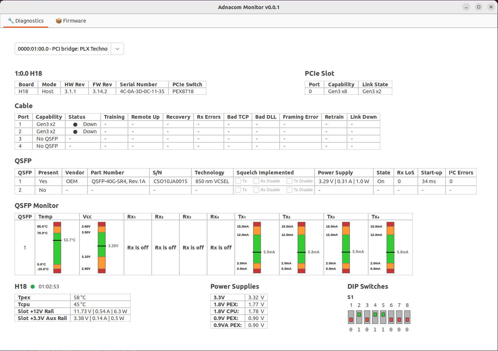
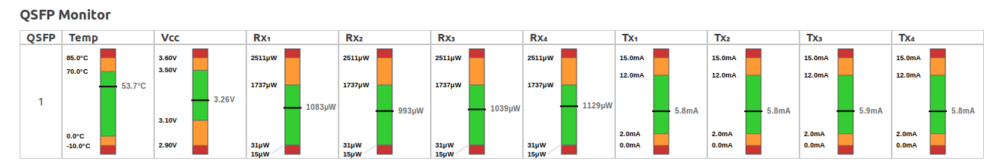
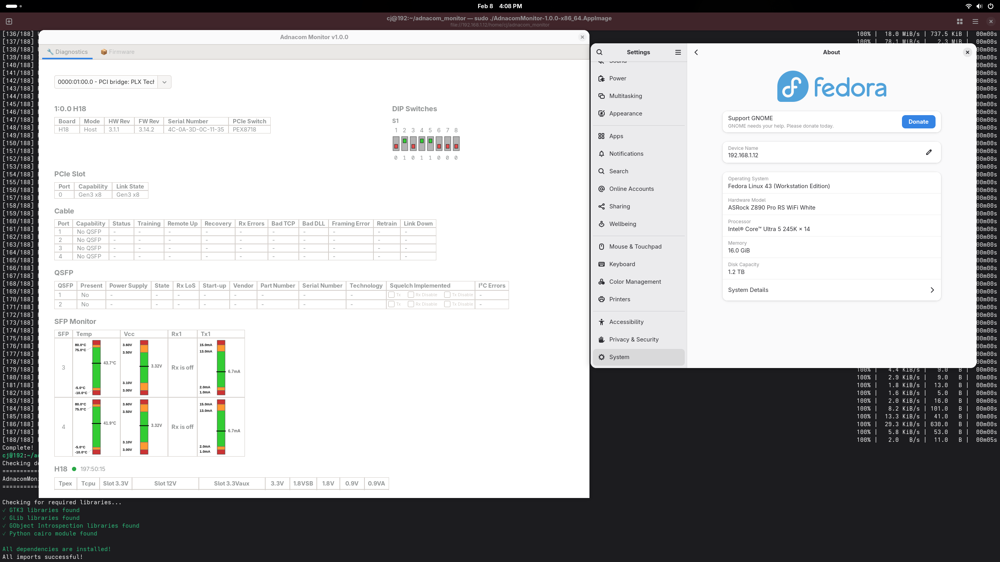
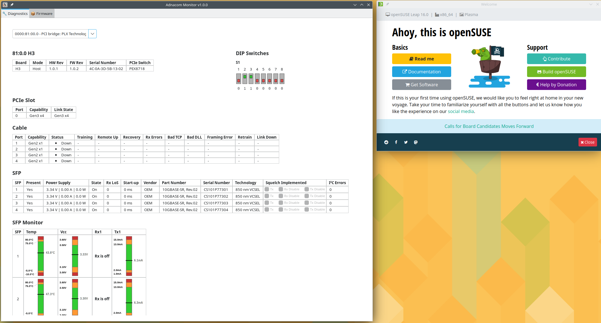

# Adnacom Monitor SDK


[](https://opensource.org/licenses/MIT)

SDK for monitoring and diagnosing Adnacom PCIe host adapters. Ships pre-compiled native libraries exposing a high-level Python API, along with a GTK3 application that serves as a reference implementation of that API.

## Screenshots




Cross-distribution compatibility:




---

## Requirements

- **Python 3.10 – 3.13** — the SDK ships pre-compiled native extensions for CPython 3.10, 3.11, 3.12 and 3.13, and the installer automatically picks the one matching your interpreter. Ubuntu 22.04 (Python 3.10), Ubuntu 24.04 (3.12), and current Fedora/openSUSE/Arch releases all work out of the box.
- Linux with GTK3 (for the GUI application).

> ⚠️ **Do NOT change the system default `python3`** (via `update-alternatives` or symlinks). Ubuntu system tools (`apt`, `gi`, `apt_pkg`) are compiled against the exact system interpreter and will break. There is no need to: the SDK works with your system's own Python. If you changed the default while following older instructions, revert it now:
> ```bash
> sudo update-alternatives --set python3 /usr/bin/python3.10
> ```

## Quick Start

Run the installer from the SDK directory. It detects your distribution and Python version, installs the required system packages, and sets up the `adnacom-venv` virtual environment — no manual steps:

```bash
bash install.sh
```

(Equivalently `./install.sh` — but depending on how the SDK was downloaded and extracted, the file may have lost its executable permission; `bash install.sh` always works. To restore the permission: `chmod +x install.sh`.)

Then jump to [Run](#run).

> During installation pip may print warnings like `WARNING: Error parsing dependencies of distro-info: Invalid version: '1.1build1'`. These are harmless — see [Troubleshooting](#warning-error-parsing-dependencies-of--during-installation) — and the line `adnacom-monitor <version> OK` at the end confirms the installation succeeded.

### Manual installation

If you prefer to run the steps yourself (any distribution, Python 3.10–3.13):

```bash
# Step 1 — system dependencies
# Ubuntu/Debian
sudo apt install python3-venv python3-gi python3-gi-cairo gir1.2-gtk-3.0 gir1.2-glib-2.0

# Fedora/RHEL
sudo dnf install python3-gobject gtk3 gobject-introspection

# openSUSE
sudo zypper install python3-gobject gtk3 gobject-introspection

# Arch Linux / Manjaro
sudo pacman -S python-gobject gtk3 gobject-introspection

# Step 2 — install the application
python3 -m venv adnacom-venv --system-site-packages
source adnacom-venv/bin/activate
adnacom-venv/bin/pip install .
```

### Run

PCIe device access requires root. Use the full path to the binary so `sudo` can find it:

```bash
sudo adnacom-venv/bin/adnacom-monitor
```

> If you see a **"cannot open display"** error, run this first, then retry:
> ```bash
> xhost +SI:localuser:root
> sudo env DISPLAY=$DISPLAY XAUTHORITY=$XAUTHORITY ~/adnacom-venv/bin/adnacom-monitor
> ```

Use the device dropdown to select a connected Adnacom adapter. All data refreshes automatically every second.

> **Upgrading from SDK ≤ 1.1.0 on Ubuntu 22.04?** Older releases only shipped extensions for Python 3.12 and required installing Python 3.12 from the deadsnakes PPA. That workaround is no longer needed — the system Python 3.10 now works directly. Simply re-run `./install.sh`; it recreates `adnacom-venv` from scratch.

---

## Troubleshooting

Search this section (Ctrl-F) for the exact error message you are seeing.

### `ImportError: cannot import name '_gi' from partially initialized module 'gi'`

**Cause:** The system default `python3` was changed to 3.12 (e.g. via `update-alternatives`), so system scripts try to load the `_gi` C extension compiled for Python 3.10 under the wrong interpreter.

**Fix:** Restore the system default — never repoint `python3` on Ubuntu:

```bash
sudo update-alternatives --set python3 /usr/bin/python3.10
```

### `ModuleNotFoundError: No module named 'apt_pkg'`

**Cause:** Same as above — `apt_pkg` is compiled only for the system Python 3.10.

**Fix:** Restore the system default `python3` (command above). If you need apt bindings under Python 3.12, additionally install `python3.12-apt`.

### `ImportError: adnacom-monitor ... ships pre-compiled modules for CPython 3.10, 3.11, 3.12, 3.13`

**Cause:** The venv was created with a Python version the SDK has no pre-compiled extension for (for example a very new interpreter).

**Fix:** Re-run `./install.sh` — it recreates the venv with a supported interpreter, or reports which versions this SDK build supports.

### `ImportError` pointing at `/usr/lib/python3/dist-packages/gi/__init__.py` while inside the venv

**Cause:** The venv's Python version differs from the system Python, but it is picking up the **system** `gi` package (compiled for the system interpreter) — typically a venv created manually with `--system-site-packages` using a non-default interpreter, or `PYTHONPATH` pointing at system dist-packages.

**Fix:** Make sure `PYTHONPATH` is unset (`unset PYTHONPATH`) and re-run `./install.sh`. It creates the venv from the system Python so the distro `gi` package matches; installs that mix a different interpreter with system site-packages are exactly what it avoids.

### `../cairo/meson.build:51:15: ERROR: Python dependency not found`

**Cause:** `pip` is compiling pycairo/PyGObject from source and the development headers for the venv's Python are missing. (This only happens when the venv does not use the system Python; `./install.sh` prefers the system Python, where no compilation is needed.)

**Fix:** Install the build dependencies for the interpreter the venv uses (here shown for 3.12), then re-run the pip install:

```bash
sudo apt install python3.12-dev libgirepository1.0-dev libcairo2-dev pkg-config gcc
```

### `WARNING: Error parsing dependencies of ...` during installation

Examples:

```
WARNING: Error parsing dependencies of distro-info: Invalid version: '1.1build1'
WARNING: Error parsing dependencies of python-debian: Invalid version: '0.1.43ubuntu1.1'
```

**Cause:** The virtual environment shares the system site-packages (so the distro's GTK bindings can be reused), which makes pip enumerate the Python packages your distribution installed via `apt`. A few of those (`distro-info`, `python-debian`, …) carry Debian-style version numbers that are not valid Python (PEP 440) versions, and pip warns that it cannot parse their metadata.

**Fix:** Nothing to fix — the warnings are cosmetic, come from Ubuntu's own packages, and do not affect the installation or the application. As long as the installer ends with `adnacom-monitor <version> OK`, everything is in order.

### `Dependency 'girepository-2.0' is required but not found`

**Cause:** PyGObject 3.52+ requires `girepository-2.0`, which only exists on Ubuntu 24.04 and newer. Ubuntu 22.04 only ships `girepository-1.0`, and the package `libgirepository2.0-dev` does not exist there.

**Fix:** Pin PyGObject below 3.52:

```bash
pip install "PyGObject<3.52"
```

---

## Features

- **Device Information**: Real-time monitoring of PCIe device status and capabilities
- **PCIe Diagnostics**: Link status, capabilities, and performance monitoring
- **Cable Diagnostics**: Connection status, error counters, and link quality
- **QSFP Monitoring**: Module detection, vendor information, and optical parameters
- **Real-time Gauges**: Temperature, voltage, and optical power monitoring with thresholds
- **Power Management**: Supply voltage and current monitoring
- **DIP Switch Configuration**: Visual representation of hardware switch settings
- **Firmware Management**: Update and manage device firmware

## Running Without Root (udev rule)

The recommended long-term setup is a `udev` rule so the application runs as a normal user without `sudo`.

Create `/etc/udev/rules.d/99-adnacom.rules`:

```
SUBSYSTEM=="pci", ATTR{vendor}=="0x10b5", ATTR{device}=="0x8718", GROUP="adnacom", MODE="0660"
SUBSYSTEM=="pci", ATTR{vendor}=="0x10b5", ATTR{device}=="0x8725", GROUP="adnacom", MODE="0660"
```

Apply the rule:

```bash
sudo groupadd --force adnacom
sudo usermod -aG adnacom $USER
sudo udevadm control --reload
sudo udevadm trigger
```

Log out and back in, then run without `sudo`:

```bash
source adnacom-venv/bin/activate
adnacom-monitor
```

## Using the SDK

```python
from adnacom_monitor.Protocol import DeviceDataReader

# Pass the PCI BDF of the adapter (find it with: lspci -Dn | grep -E "10b5:(8718|8725)")
info = DeviceDataReader.read_device_info("0000:03:00.0")
print(info["board"], info["fw_rev"])
```

See [DEVELOPER_GUIDE.md](DEVELOPER_GUIDE.md) for the full API reference.

## Development

```bash
git clone https://github.com/adnacom/pcisw-api-linux.git
cd pcisw-api-linux
python3 -m venv adnacom-venv --system-site-packages
source adnacom-venv/bin/activate
pip install -e ".[dev]"

python -m pytest       # run tests
python -m black .      # format
python -m flake8 .     # lint
python -m mypy .       # type-check
```

> Use `python -m …` rather than the bare tool names. Because the venv is created with `--system-site-packages`, a tool already installed on your system (e.g. `pip install --user pytest`) is skipped during `pip install -e ".[dev]"` and the bare command would run outside the venv, failing with `ModuleNotFoundError: No module named 'adnacom_monitor'`.

## License

This project is licensed under the MIT License — see the [LICENSE](LICENSE) file for details. See [NOTICE](NOTICE) for information about the components (`Protocol`, `firmware`) that are distributed in binary-only form.
